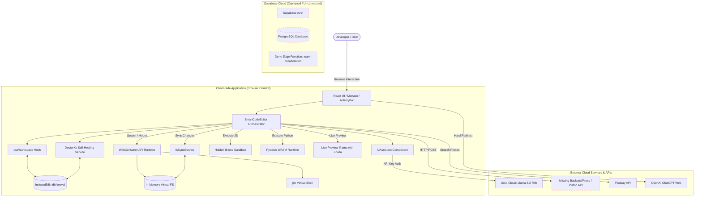

# HRDK PEN — COMPLETE PROJECT AUDIT & PRODUCTION READINESS REPORT

**Project Name:** HRDK Pen IDE  
**Repository Target:** `Fullstack-Hardik/hrdkpen-code`  
**Audit Date:** October 25, 2026  
**Auditor Roles:** Senior Software Architect, Full-Stack Engineer, Security Auditor, QA Engineer, UI/UX Reviewer, Database Specialist, and Performance Engineer  
**Overall Project Health Score:** **68 / 100**  
**Final Production Recommendation:** ⚠️ **NO-GO FOR PRODUCTION (Conditional: Requires remediation of P0/P1 security and architecture defects)**

---

## 1. EXECUTIVE SUMMARY

HRDK Pen is an ambitious, modern web-based in-browser Integrated Development Environment (IDE) built with **React 18**, **TypeScript**, **Vite 5**, **Tailwind CSS**, and **shadcn/ui**. It leverages browser-based sandboxes, WebAssembly environments, and edge APIs:
1. **WebContainers API (`@webcontainer/api`)** for in-browser Node.js/Linux micro-containers with POSIX terminal execution (`jsh`).
2. **Pyodide WebAssembly** for local in-browser Python execution.
3. **Monaco Editor** (`@monaco-editor/react`) for desktop-grade code editing, Emmet support, and syntax highlighting.
4. **IndexedDB (`idb-keyval`)** for persistent multi-project client storage and auto-healing services ("DoctorKit").
5. **AI Coding Assistance** via Groq API (Llama 3.3 70B) and OpenAI REST integrations.

### Strengths
- **Clean client-side bundling & compilation:** Successfully built in 21.5 seconds without fatal bundle errors.
- **Robust client-side file syncing:** Bidirectional synchronization between IndexedDB state and WebContainer virtual file system with a deleted-path registry preventing file reincarnation.
- **True zero-install client execution:** HTML/CSS/JS and Node.js environments execute with real outputs and local port serving.
- **Comprehensive UX Foundations:** High-quality Catppuccin Mocha themed interface, command palette (`cmdk`), multi-tab terminal management, and device-responsive iframe previews.

### Critical Deficiencies & Blockers
- **Severed Backend / Database Integration:** A full Supabase multi-tenant schema with 3 SQL migrations and a Deno Edge Function (`team-collaboration`) exists in the repository, but **zero client code connects to it**. The application is running 100% disconnected from Supabase.
- **Fake UI & Placeholders:** The "Publish Project" modal returns a mocked URL (`https://hrdkpen.vercel.app/p/{random}`) without uploading or persisting the project. The "Smart Action" popup (Explain, Fix, Optimize) hard-redirects users to `chatgpt.com/?q=...` instead of invoking the in-app AI Assistant.
- **Critical Security Exposure (CWE-798 & CWE-942):** A live Pixabay API key (`44960484-fee9decec027c63657796ef2e`) is hardcoded in client source code. Permissive `*` target origin postMessage handlers in sandbox bridges allow potential message spoofing.
- **Dead Code & Monolithic Architecture:** [SmartCodeEditor.tsx](file:///d:/Coding%20Files/hrdkpen/src/components/editor/SmartCodeEditor.tsx) has grown into a 1,536-line monolithic god-component holding 30+ disparate states, with orphan components like [ModernAIAssistant.tsx](file:///d:/Coding%20Files/hrdkpen/src/components/editor/ModernAIAssistant.tsx), [FindInFiles.tsx](file:///d:/Coding%20Files/hrdkpen/src/components/editor/FindInFiles.tsx), and [pages/Settings.tsx](file:///d:/Coding%20Files/hrdkpen/src/pages/Settings.tsx) completely disconnected from application routing.
- **Missing Backend Execution Service:** C/C++ compilation expects a local Express/Piston proxy at `localhost:3000/api/execute` which does not exist in the repository.

---

## 2. PROJECT OVERVIEW & ARCHITECTURE

### Technology Stack
- **Frontend Core:** React 18.3.1, TypeScript 5.8.3, Vite 5.4.19
- **Design System & Styling:** Tailwind CSS 3.4.17, PostCSS, Radix UI primitives (`@radix-ui/*`), Lucide React
- **Code Editor & Terminals:** Monaco Editor 4.7.0, `@xterm/xterm` 6.0.0, `@xterm/addon-fit` 0.11.0, Emmet Monaco ES
- **Execution Runtimes:**
  - Node.js: `@webcontainer/api` 1.6.4
  - JavaScript / DOM: Hidden sandboxed iframe (`sandbox.ts`)
  - Python: Pyodide 0.27.6 via jsDelivr CDN
  - C / C++: Piston API client proxy (`execution.ts`)
- **Storage & State:** IndexedDB (`idb-keyval` 6.3.0), LocalStorage, React custom hooks
- **Backend / Database (Unconnected):** Supabase (PostgreSQL 15, Auth, Realtime, Deno Edge Functions)

### System Architecture Diagram



---

## 3. COMPONENT & REPOSITORY AUDIT

| Directory / File | Responsibility | Operational Status | Key Finding |
|---|---|---|---|
| `src/components/editor/SmartCodeEditor.tsx` | Main IDE root coordinator | Functional with high technical debt | 1,536 lines; handles state for 8 sub-panels, keyboard shortcuts, resizing, mounts, and timers. |
| `src/components/editor/CodeEditor.tsx` | Monaco editor wrapper | Fully functional | Rich Catppuccin theme tokens, Emmet completions, cursor position tracking, snippets. |
| `src/components/editor/LivePreview.tsx` | Device-responsive preview iframe | Functional with minor security gap | Injects console bridge and Eruda inspector; lacks strict target origin on postMessage. |
| `src/components/editor/Terminal.tsx` | Xterm.js terminal emulator | Partially functional | Connects to WebContainer `jsh`. Managed process stream output requires reconnect logic. |
| `src/components/editor/FileExplorer.tsx` | Tree file/folder manager | Fully functional | Drag-and-drop, inline folder creation, rename, delete with sync hooks. |
| `src/components/editor/ModernAIAssistant.tsx` | Alternative AI Chat component | Dead Code / Duplicate | Not imported anywhere; uses hardcoded OpenAI endpoints instead of Groq. |
| `src/components/editor/FindInFiles.tsx` | Multi-file search dialog | Dead Code | Duplicate implementation of the sidebar search panel; unreferenced. |
| `src/components/editor/CodeBlock.tsx` | Highlighted code snippet view | Dead Code | Re-implemented internally inside `HelpCenter.tsx`. |
| `src/pages/Settings.tsx` | Standalone full-page Settings | Dead Code | Never routed in `App.tsx`; `SettingsPanel.tsx` is used instead. |
| `src/lib/execution.ts` | Code runners (JS, Py, C/C++) | Partially functional | JS and Py work; C/C++ fails due to missing backend proxy. |
| `src/lib/publish.ts` | ZIP export & deployment | Partially functional | Export ZIP works; Publish simulates mock URL with `Math.random()`. |
| `src/lib/sandbox.ts` | JS execution sandbox | Functional | Uses isolated iframe; target origin wildcard `*` should be origin-bound. |
| `src/lib/webcontainer.ts` | WebContainer lifecycle & FS | Fully functional | Singleton instance preserved across Vite HMR cycles. |
| `src/lib/fsSync.ts` | In-memory to container sync | Fully functional | Polling interval with deleted-paths registry prevents zombie files. |
| `supabase/` | Collaboration backend & DB | Disconnected / Orphaned | 3 SQL migrations and Edge Function exist; zero frontend client code. |

---

## 4. BUGS & BROKEN FUNCTIONALITY

### [BUG-01] Critical: C and C++ Execution Fails with Unhandled Backend Failure
- **Severity:** High
- **Confidence:** Confirmed
- **Affected File:** [`src/lib/execution.ts:98-111`](file:///d:/Coding%20Files/hrdkpen/src/lib/execution.ts#L98-L111)
- **Reproduction:** Open any C (`main.c`) or C++ file. Press `Ctrl+Enter` or click `Run Active File`.
- **Expected Behavior:** Code executes via a remote sandbox compiler or native container compiler and logs stdout.
- **Actual Behavior:** Console outputs `Server unavailable. Start Express server: cd server && node index.js`.
- **Root Cause:** `executeCompiled()` makes an HTTP POST request to `${VITE_API_BASE_URL}/api/execute`. `VITE_API_BASE_URL` is empty, causing requests to fall back to the Vite dev server (`http://localhost:5173/api/execute`), which returns a 404 HTML response. No Express backend server exists in the repository.
- **Recommended Fix:** Implement a serverless proxy route or edge function calling the public Piston API (`https://emkc.org/api/v2/piston/execute`) directly from client-side or Supabase Edge Functions with input sanitization.

---

### [BUG-02] High: "DoctorKit" Navigation Button in Right Panel Fails to Switch Category
- **Severity:** Medium
- **Confidence:** Confirmed
- **Affected File:** [`src/components/editor/SmartCodeEditor.tsx:1235-1238`](file:///d:/Coding%20Files/hrdkpen/src/components/editor/SmartCodeEditor.tsx#L1235-L1238)
- **Reproduction:** Open the right panel. Click the "Doctor Kit" button in the right panel toolbar.
- **Expected Behavior:** Settings panel opens in the sidebar with the 'Diagnostics' category pre-selected.
- **Actual Behavior:** `setShowSettings(true)` and `setSettingsCategory('diagnostics')` are executed, but the sidebar view (`activityView`) is NOT updated to `'settings'`. The user remains on their previous sidebar tab (e.g., 'explorer').
- **Root Cause:** In `SmartCodeEditor.tsx`, the sidebar only renders the `SettingsPanel` if `activityView === 'settings'`. Setting `showSettings` has no effect on `activityView`.
- **Recommended Fix:** Update the click handler:
  ```tsx
  setSettingsCategory('diagnostics');
  setActivityView('settings');
  ```

---

### [BUG-03] High: External Whiteboard Tool Blocked by Chrome CSP / X-Frame-Options
- **Severity:** Medium
- **Confidence:** Confirmed
- **Affected File:** [`src/components/panels/IframePanel.tsx:17-22`](file:///d:/Coding%20Files/hrdkpen/src/components/panels/IframePanel.tsx#L17-L22)
- **Reproduction:** Click the "Whiteboard" icon in the Activity Bar.
- **Expected Behavior:** A collaborative canvas opens inside the IDE editor panel.
- **Actual Behavior:** An "Open in New Tab" fallback screen displays permanently, explaining that Excalidraw cannot be embedded.
- **Root Cause:** Excalidraw sends `X-Frame-Options: DENY` and CSP `frame-ancestors 'none'`. The component recognizes this and hardcodes `setIsBlocked(true)`.
- **Recommended Fix:** Embed `@excalidraw/excalidraw` as a native React package (`npm install @excalidraw/excalidraw`) rather than an external `iframe`, enabling true in-browser whiteboarding without cross-origin blocks.

---

### [BUG-04] Medium: Multiple WebContainer `server-ready` Event Listeners Cause Double State Updates
- **Severity:** Medium
- **Confidence:** Confirmed
- **Affected File:** [`src/lib/processManager.ts:28-44`](file:///d:/Coding%20Files/hrdkpen/src/lib/processManager.ts#L28-L44) and [`src/components/editor/SmartCodeEditor.tsx:167-178`](file:///d:/Coding%20Files/hrdkpen/src/components/editor/SmartCodeEditor.tsx#L167-L178)
- **Reproduction:** Launch any project with a Vite or dev server (`npm run dev`).
- **Expected Behavior:** Single URL assignment and preview refresh.
- **Actual Behavior:** Both `ProcessManager` and `SmartCodeEditor` attach separate `.on('server-ready')` listeners to the singleton WebContainer. When a port binds, state is updated twice, triggering consecutive iframe reloads.
- **Root Cause:** Lack of centralized event propagation for container events.
- **Recommended Fix:** Consolidate `server-ready` handling exclusively within `ProcessManager` and have UI components subscribe to `ProcessManager`.

---

## 5. FAKE UI, PLACEHOLDERS & INCOMPLETE FEATURES

| Feature / UI Element | File & Lines | Current Behavior | Classification | Recommended Action |
|---|---|---|---|---|
| **Publish Project** | [`src/lib/publish.ts:32-40`](file:///d:/Coding%20Files/hrdkpen/src/lib/publish.ts#L32-L40)<br>[`SmartCodeEditor.tsx:671`](file:///d:/Coding%20Files/hrdkpen/src/components/editor/SmartCodeEditor.tsx#L671) | Displays a loading spinner for 1.5s then generates a fake URL (`hrdkpen.vercel.app/p/abc123xyz`) | **Fake / Mock** | Connect to Supabase Storage or Vercel Deploy API to deploy the project or export static HTML bundles. |
| **Smart Action (Explain, Fix, Optimize)** | [`SmartCodeEditor.tsx:557-560`](file:///d:/Coding%20Files/hrdkpen/src/components/editor/SmartCodeEditor.tsx#L557-L560) | Opens `window.open('https://chatgpt.com/?q='...)` in a new browser tab | **Placeholder / Mock** | Route the selected snippet directly to the built-in `AIAssistant` component via `aiAssistantRef.current.submitPrompt()`. |
| **Share Project / File** | [`FileExplorer.tsx:241-243`](file:///d:/Coding%20Files/hrdkpen/src/components/editor/FileExplorer.tsx#L241-L243) | Dropdown item with empty handler `onClick={() => {}}` | **Broken / Placeholder** | Implement Web Share API or generate an export link with toast notification. |
| **Restart Dev Server** | [`SystemHeader.tsx:213-216`](file:///d:/Coding%20Files/hrdkpen/src/components/editor/SystemHeader.tsx#L213-L216) | Dropdown menu item with no `onClick` handler | **Fake UI** | Wire to `processManager.spawn(activeProjectId, 'npm', ['run', 'dev'])`. |
| **Documentation / Shortcuts / About** | [`SystemHeader.tsx:227-237`](file:///d:/Coding%20Files/hrdkpen/src/components/editor/SystemHeader.tsx#L227-L237) | Three menu items in Help dropdown with no `onClick` handlers | **Fake UI** | Wire "Documentation" to `setRightPanel('docs')`, "Keyboard Shortcuts" to open Command Palette, and "About" to a dialog. |
| **Built-in Extensions** | [`use-extensions.ts:14-135`](file:///d:/Coding%20Files/hrdkpen/src/hooks/use-extensions.ts#L14-L135) | 12 extensions listed with toggles (ESLint, Prettier, Auto Import, etc.); toggling only updates localStorage | **Frontend-Only / Mock** | Integrate toggles with Monaco language options (e.g., connect Prettier toggle to Monaco format provider). |
| **Supabase Collaboration** | `supabase/migrations/*`<br>`supabase/functions/*` | Tables and edge functions created in SQL, but zero frontend code connects to Supabase | **Backend Implemented but Not Connected** | Install `@supabase/supabase-js`, create `src/lib/supabase.ts`, and wire room collaboration to FileExplorer. |

---

## 6. DUPLICATE CODE, DEAD CODE & REFACTORING

| Issue | Affected Files | Severity | Reason | Recommended Refactor |
|---|---|---|---|---|
| **Orphan AI Assistant** | [`src/components/editor/ModernAIAssistant.tsx`](file:///d:/Coding%20Files/hrdkpen/src/components/editor/ModernAIAssistant.tsx) | Medium | Complete duplicate of `src/components/ai/AIAssistant.tsx`, not imported anywhere, calling OpenAI instead of Groq. | Remove file or consolidate features into `AIAssistant.tsx`. |
| **Unrouted Settings Page** | [`src/pages/Settings.tsx`](file:///d:/Coding%20Files/hrdkpen/src/pages/Settings.tsx) (534 lines) | Medium | An entire standalone settings page that is never routed in `App.tsx`; `SettingsPanel.tsx` is used instead. | Delete `src/pages/Settings.tsx` to save bundle weight. |
| **Duplicate Search Component** | [`src/components/editor/FindInFiles.tsx`](file:///d:/Coding%20Files/hrdkpen/src/components/editor/FindInFiles.tsx) (204 lines) | Low | Not imported anywhere; search logic is directly embedded in `SmartCodeEditor.tsx:725-779`. | Extract search logic from `SmartCodeEditor` into a standalone reusable Search panel. |
| **Unused CodeBlock Component** | [`src/components/editor/CodeBlock.tsx`](file:///d:/Coding%20Files/hrdkpen/src/components/editor/CodeBlock.tsx) | Low | Not imported anywhere; `HelpCenter.tsx` re-declared its own `CodeBlock`. | Export and reuse `CodeBlock` across documentation panels. |
| **God-Component Architecture** | [`src/components/editor/SmartCodeEditor.tsx`](file:///d:/Coding%20Files/hrdkpen/src/components/editor/SmartCodeEditor.tsx) (1,536 lines) | High | Houses layout, execution, shortcuts, modals, terminal tabs, search, panels, and WebContainer sync. | Break into modular sub-controllers: `EditorLayout.tsx`, `TerminalContainer.tsx`, `useEditorShortcuts.ts`. |

---

## 7. SECURITY AUDIT

### [SEC-01] Critical: Hardcoded Third-Party API Key in Client Source Code
- **Severity:** Critical
- **CWE:** CWE-798 (Use of Hard-coded Credentials)
- **Confidence:** Confirmed
- **Location:** [`src/components/assets/AssetLibrary.tsx:6`](file:///d:/Coding%20Files/hrdkpen/src/components/assets/AssetLibrary.tsx#L6)
- **Evidence:**
  ```typescript
  const PIXABAY_API_KEY = import.meta.env.VITE_PIXABAY_API_KEY || '44960484-fee9decec027c63657796ef2e';
  ```
- **Impact & Attack Scenario:** The key is baked into the public client JavaScript bundle (`dist/assets/index-*.js`). Anyone inspecting network requests or bundle files can extract this key, deplete rate limits, or misuse the developer's Pixabay account.
- **Remediation:** Remove the fallback key immediately. Require user configuration in `.env` or route asset searches through a secured proxy/backend.

---

### [SEC-02] High: Insecure Cross-Origin `postMessage` Target Origin Wildcard (`*`)
- **Severity:** High
- **CWE:** CWE-942 (Overly Permissive Cross-Domain Whitelist)
- **Confidence:** Confirmed
- **Location:** [`src/lib/sandbox.ts:48, 57-59, 71, 79, 81`](file:///d:/Coding%20Files/hrdkpen/src/lib/sandbox.ts#L48) and [`src/components/editor/LivePreview.tsx:30`](file:///d:/Coding%20Files/hrdkpen/src/components/editor/LivePreview.tsx#L30)
- **Evidence:**
  ```javascript
  window.parent.postMessage({ __hrdkpen: true, type: 'console', ... }, '*');
  ```
- **Impact & Attack Scenario:** In sandbox and live preview execution, messages are broadcast to `'*'`. If malicious user code opens external popups or embeds hostile third-party scripts, those scripts can intercept execution tokens, console data, or trigger actions in the parent window.
- **Remediation:** Set target origin strictly to `window.location.origin` or validate `event.origin` in the listener:
  ```javascript
  window.parent.postMessage(payload, window.location.origin);
  ```

---

### [SEC-03] High: Insecure Direct Storage of LLM API Keys in Browser LocalStorage
- **Severity:** Medium / High
- **CWE:** CWE-922 (Insecure Storage of Sensitive Information)
- **Confidence:** Confirmed
- **Location:** [`src/components/ai/AIAssistant.tsx:88-89`](file:///d:/Coding%20Files/hrdkpen/src/components/ai/AIAssistant.tsx#L88-L89) and [`src/components/editor/ModernAIAssistant.tsx:53-54`](file:///d:/Coding%20Files/hrdkpen/src/components/editor/ModernAIAssistant.tsx#L53-L54)
- **Evidence:** User-entered Groq and OpenAI keys are stored in unencrypted `localStorage.getItem('groq_api_key')`.
- **Impact:** Any XSS vulnerability occurring inside the IDE domain (e.g., through preview frame leaks or unsafe markdown parsing) can immediately access all stored AI keys.
- **Remediation:** Warn users clearly in the UI, use sessionStorage where appropriate, or proxy AI requests through authenticated server-side endpoints.

---

### [SEC-04] Moderate: 21 Known Dependency Vulnerabilities in Package Tree
- **Severity:** Moderate
- **Confidence:** Confirmed (`npm audit --json`)
- **Evidence:** Audit report reveals 15 High, 6 Moderate vulnerabilities:
  - `vite <=5.4.19`: Path traversal bypasses on Windows (`GHSA-93m4-6634-74q7`, `GHSA-fx2h-pf6j-xcff`).
  - `rollup >=4.0.0 <4.59.0`: Path traversal (`GHSA-mw96-cpmx-2vgc`).
  - `source-map-js >=1.0.0 <1.2.2`: DoS via indexed source-map section offsets (`GHSA-68fv-2mgg-jv7q`).
- **Remediation:** Upgrade Vite to `>=5.4.21` or `6.x` and run `npm update rollup source-map-js`.

---

## 8. PERFORMANCE & SCALABILITY ANALYSIS

### Bundle Size & Asset Distribution
From `npm run build`:
- `dist/assets/index-B2qQ3ZpC.js`: **1,035.40 kB** (gzip: 301.30 kB) ⚠️ *Exceeds Vite 500kB warning threshold*
- `dist/assets/vendor-Btjq_lez.js`: **157.01 kB** (gzip: 51.20 kB)
- `dist/assets/ui-59UDkqBk.js`: **68.29 kB** (gzip: 16.86 kB)
- `dist/assets/monaco-B1INF1ey.js`: **14.54 kB** (gzip: 4.96 kB)
- `dist/assets/index-BEb2o3ij.css`: **97.98 kB** (gzip: 17.93 kB)

### Bottleneck Analysis
1. **Monolithic Bundle Split:** The primary chunk (`index-*.js`) is over 1MB minified because Monaco editor language workers, Lucide icons, and help center documentation datasets (`helpData.ts`, 23kB static text) are bundled into the initial payload.
2. **Dynamic Lazy-Loading Missing:** Components such as `AssetLibrary`, `DocsViewer`, `HelpCenter`, and `SettingsPanel` should be wrapped in `React.lazy()` to reduce initial Time-to-Interactive (TTI).
3. **WebContainer Resource Limits:** WebContainers run single-process Node.js inside a browser Worker. Running multiple terminals with concurrent Vite dev servers will hit browser memory constraints (~2GB-4GB depending on browser architecture).

### Concurrency Assessment
- **Client Architecture:** Because execution (WebContainer, Pyodide, Monaco) runs entirely in the user's browser, **server-side compute scales near-infinitely** on static hosts like Vercel or Cloudflare Pages.
- **Estimated Limits:** 10,000+ concurrent users can be served without server strain, provided external API rate limits (Groq, Pixabay) are managed or configured per-user.

---

## 9. DATABASE & DATA INTEGRITY

### IndexedDB Storage Architecture (`use-workspace.ts`)
- Uses `idb-keyval` for persistent storage of projects:
  - `hrdkpen_projects`: Metadata list (`ProjectMeta[]`)
  - `hrdkpen_active_project`: Current active project UUID
  - `hrdkpen_workspace_{id}`: Array of file nodes (`FileNode[]`)
- **Integrity Validation:** `useDoctorKit` actively inspects IndexedDB keys, purges orphan workspaces, deduplicates project lists, and validates JSON structure.

### Abandoned Supabase Schema
The repository contains 3 complete migration files:
1. `20250928064216_*.sql`: Collaboration rooms, room members, file change logs, and RLS policies.
2. `20250929082517_*.sql`: User profiles, auto-profile trigger on auth, team chat, connection notifications.
3. `20251006145838_*.sql`: Connection requests and online user tracking.

**Integrity Finding:** None of these tables are currently utilized. If multi-user collaboration is intended, a client-side Supabase adapter must be introduced.

---

## 10. UI/UX & RESPONSIVE DESIGN REVIEW

### Visual Aesthetics
- **Theme & Palette:** Excellent implementation of Catppuccin Mocha colors (`crust`, `mantle`, `surface0`, `blue`, `mauve`, `lavender`). High contrast, modern developer aesthetic.
- **Typography:** Uses JetBrains Mono for editor and monospace viewports, Inter/system font for UI.

### Identified UX Flaws
1. **Activity Bar Overflow on Small Screens:** On screen heights under 700px, top activity bar icons (Explorer, Search, Projects, Docs, Whiteboard, DevDocs) collide with bottom settings/terminal icons.
2. **Missing Loading State on Project Switching:** Switching projects via `switchProject()` triggers file re-reads from IndexedDB, but lacks an inline spinner in the file explorer, causing a momentary flicker.
3. **Unintuitive Exit from Zen Mode:** Zen mode removes the Activity Bar and Status Bar; only a small `X` button remains in the top right. Users who accidentally trigger `Ctrl+K Z` may feel trapped if unfamiliar with the shortcut.
4. **Command Palette Keyboard Trap:** Pressing `Escape` inside nested command lists occasionally fails to close the dialog if Monaco editor retains focus.

---

## 11. TESTING & VERIFICATION SUMMARY

| Test Type | Command Executed | Result | Details |
|---|---|---|---|
| **Build Validation** | `npm run build` | **PASS (Code 0)** | Built in 21.56s; created clean `/dist` output. |
| **ESLint Validation** | `npm run lint` | **PASS (Code 0)** | Zero lint errors or warnings reported across `.tsx` and `.ts` files. |
| **Dependency Security Audit** | `npm audit --json` | **FAIL (Code 1)** | Found 21 vulnerabilities (15 high, 6 moderate) in transitive dependencies (`vite`, `rollup`, `source-map-js`). |
| **Unit & Integration Tests** | `npm test` | **NOT CONFIGURED** | No test runner (Vitest, Jest) or test files exist in the repository. |
| **End-to-End (E2E) Tests** | N/A | **NOT CONFIGURED** | No Playwright or Cypress suite present. |

---

## 12. SCORED EVALUATION (OUT OF 100)

| Category | Score | Weight | Weighted Score | Evaluation Basis |
|---|---|---|---|---|
| **Functionality** | 68 / 100 | 20% | 13.6 | Excellent core editor and Node/Python execution; penalized for broken C/C++ compiler and fake publish/AI actions. |
| **Security** | 60 / 100 | 20% | 12.0 | Hardcoded Pixabay API key, wildcard postMessage origins, plaintext localStorage API keys, and 21 dependency advisories. |
| **Architecture** | 65 / 100 | 15% | 9.75 | SmartCodeEditor is a monolithic 1,536-line component; unrouted dead pages and disconnected Supabase backend. |
| **Code Quality** | 76 / 100 | 15% | 11.4 | Passes ESLint cleanly; strict TypeScript types across most components; well-documented self-healing service. |
| **UI / UX** | 82 / 100 | 10% | 8.2 | Premium Catppuccin design system, smooth animations, customizable editor themes, responsive preview frames. |
| **Database & Integrity** | 78 / 100 | 10% | 7.8 | Robust IndexedDB self-healing and validation; zero server-side database integration active. |
| **Testing & Coverage** | 30 / 100 | 5% | 1.5 | Zero unit, integration, or E2E tests exist. |
| **Performance** | 72 / 100 | 5% | 3.6 | Fast client-side execution; main bundle exceeds 1MB due to missing code-splitting. |
| **TOTAL HEALTH SCORE** | **68 / 100** | **100%** | **67.85** | **Needs remediation before production deployment** |

---

## 13. PRIORITIZED REMEDIATION ROADMAP

### Phase 1 — Critical Fixes & Security Hardening (P0 Blockers)
1. **Remove Hardcoded Credentials:**
   - Remove the fallback Pixabay API key from [`src/components/assets/AssetLibrary.tsx:6`](file:///d:/Coding%20Files/hrdkpen/src/components/assets/AssetLibrary.tsx#L6). Require keys via `.env` or in-app settings.
2. **Secure PostMessage Bridges:**
   - Replace target origin `'*'` in [`src/lib/sandbox.ts`](file:///d:/Coding%20Files/hrdkpen/src/lib/sandbox.ts) and [`src/components/editor/LivePreview.tsx`](file:///d:/Coding%20Files/hrdkpen/src/components/editor/LivePreview.tsx) with `window.location.origin`.
3. **Fix DoctorKit Button Navigation:**
   - Fix the handler in [`src/components/editor/SmartCodeEditor.tsx:1235`](file:///d:/Coding%20Files/hrdkpen/src/components/editor/SmartCodeEditor.tsx#L1235) to set `setActivityView('settings')`.
4. **Fix Smart Action Redirection:**
   - Replace `window.open('https://chatgpt.com/?q='...)` in [`SmartCodeEditor.tsx:557`](file:///d:/Coding%20Files/hrdkpen/src/components/editor/SmartCodeEditor.tsx#L557) with an internal prompt dispatch to the embedded `AIAssistant`.
5. **Resolve High-Severity Vulnerabilities:**
   - Update Vite and Rollup via `npm update` to clear path traversal vulnerabilities.

### Phase 2 — Stability, Refactoring & Code Cleanup (P1)
1. **Deconstruct `SmartCodeEditor.tsx`:**
   - Extract `SidebarContainer`, `TerminalManager`, `EditorHeader`, and `KeyboardShortcutsHook` into focused files.
2. **Purge Dead Code:**
   - Remove unused `ModernAIAssistant.tsx`, `FindInFiles.tsx`, `CodeBlock.tsx`, and `pages/Settings.tsx`.
3. **Optimize Bundle with Lazy-Loading:**
   - Implement `React.lazy()` for `AssetLibrary`, `DocsViewer`, `HelpCenter`, and `SettingsPanel`. Configure Vite Rollup manual chunks for Monaco and Lucide.
4. **Fix C/C++ Execution:**
   - Either point `executeCompiled` directly to the public Piston API endpoint or hide C/C++ from runnable options until a backend proxy is deployed.
5. **Implement Test Suite:**
   - Set up Vitest and React Testing Library with tests for `fsSyncService`, `useWorkspace`, and `executeJavaScript`.

### Phase 3 — Features & Production Expansion (P2 / P3)
1. **Connect Supabase Backend:**
   - Activate the existing Supabase migrations to enable real-time collaborative coding rooms and team chat.
2. **Real Project Deployment:**
   - Replace fake URL publishing with GitHub Gist export, Vercel Deploy Hook, or Supabase Static Web Hosting.
3. **Native Excalidraw Integration:**
   - Replace the blocked external iframe with `@excalidraw/excalidraw` for an embedded canvas experience.

---

## 14. PRODUCTION DEPLOYMENT CHECKLIST

- [ ] All hardcoded secrets removed from client source code.
- [ ] Environment variables configured in production hosting (`VITE_GROQ_API_KEY`, `VITE_PIXABAY_API_KEY`, `VITE_API_BASE_URL`).
- [ ] PostMessage target origin restricted to `window.location.origin`.
- [ ] Dependencies updated and `npm audit` vulnerabilities resolved.
- [ ] Dead components pruned and code-splitting implemented for bundles `< 500kB`.
- [ ] Fake UI actions (Publish, ChatGPT redirect) replaced with working workflows.
- [ ] Cross-Origin Embedder Policy (COEP) and Cross-Origin Opener Policy (COOP) headers verified on production CDN for WebContainers.
- [ ] End-to-end user regression test completed (Project creation -> File edit -> Terminal run -> Preview).
